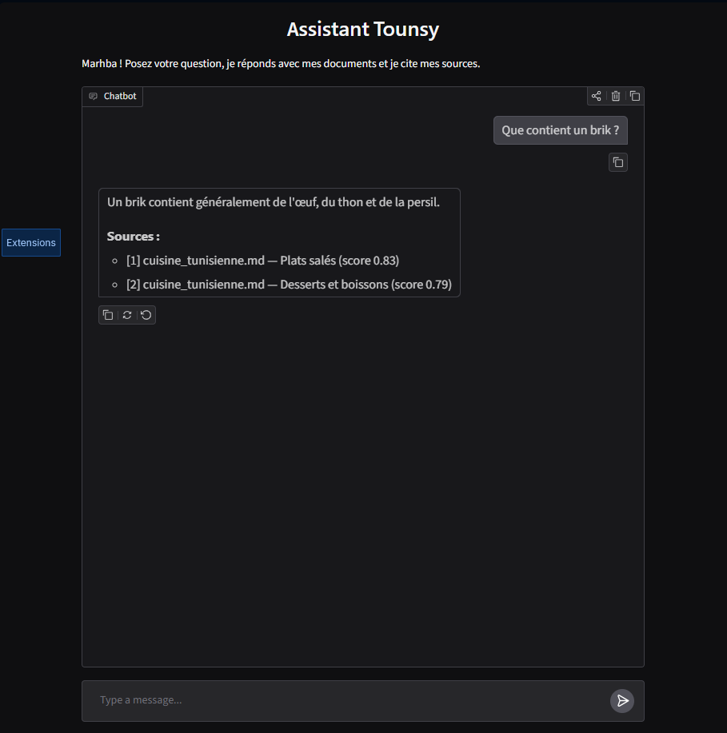
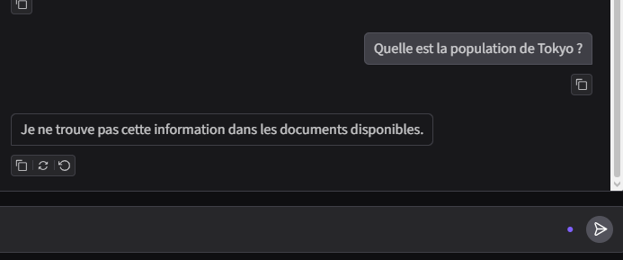

# Assistant documentaire Tunis (RAG)

Assistant (chat dans le navigateur) qui répond à des questions sur Tunis **uniquement à partir de documents** (TXT, Markdown, Word, PDF) et **cite ses sources** avec le fichier, la section et, pour un PDF, le numéro de page. Si les documents ne contiennent pas la réponse, il le dit au lieu d'inventer.

## Démo

Une question dans le corpus : la réponse est suivie des documents, sections et scores des extraits retrouvés.



Une question hors corpus, ici proche du thème de la cuisine : le système refuse de répondre au lieu d'inventer, et n'affiche aucune source.



## Architecture

```
Fichier (txt / md / docx / pdf)          tunis_rag/loader.py
        │  une section par page pour un PDF
        ▼
Découpage par paragraphes + titres        tunis_rag/chunker.py
        │
        ▼
Embeddings multilingues (MiniLM)          tunis_rag/embeddings.py
        │
        ▼
ChromaDB (similarité cosinus, persistant) tunis_rag/store.py
        │  question → top-k morceaux + score
        ▼
Filtre : score < MIN_SCORE ──► « Je ne trouve pas… » (le LLM n'est pas appelé)
        │
        ▼
Prompt avec extraits numérotés [1] [2]…   tunis_rag/rag.py
        │
        ▼
LLM local Qwen2.5-1.5B (Transformers)     tunis_rag/llm.py
        │
        ▼
Réponse + sources                         app.py (Gradio)
```

## Choix techniques

- **Un paragraphe = un morceau** : on ne coupe jamais un paragraphe au milieu, et chaque morceau garde le titre de sa section.
- **Le titre de section est ajouté au texte vectorisé** pour mieux situer chaque passage.
- **ChromaDB** : l'index est enregistré sur disque et garde le fichier, la page et la section de chaque morceau, ce qui permet d'afficher les sources.
- **Refus en deux étapes** : sous le score `MIN_SCORE`, le LLM n'est pas appelé ; au-dessus, la consigne du prompt lui demande de refuser si les extraits ne contiennent pas la réponse. Aucune source n'est affichée sous un refus. Le seuil se calibre avec `scripts/evaluate.py`.
- **Réimporter un fichier remplace** son ancienne version dans la base.
- **LLM injectable** : `RagService` accepte tout objet avec une méthode `generate`, ce qui permet de tester sans charger le modèle.

## Installation

Prérequis : Python 3.10 ou plus.

```bash
python -m venv .venv
source .venv/bin/activate          # Windows : .venv\Scripts\activate
pip install -r requirements.txt
```

Le premier lancement télécharge deux modèles : les embeddings (~0,5 Go) et Qwen2.5-1.5B (~3 Go).
Une connexion internet est nécessaire à ce moment-là seulement. Pour changer de modèle,
définis la variable d'environnement `LLM_MODEL` ou modifie `tunis_rag/config.py`.

## Utilisation

```bash
python -m scripts.ingest                  # indexe les documents de data/tunis
python -m scripts.ingest mon_fichier.pdf  # ajoute un seul fichier
python app.py                             # chat dans le navigateur (http://127.0.0.1:7860)
python -m scripts.evaluate                # Hit@3 et scores pour choisir MIN_SCORE
```

## Évaluation

`eval/questions.json` contient 10 questions : 7 avec le document attendu (une par document) et 3 hors corpus, pour lesquelles le système doit refuser de répondre. `scripts/evaluate.py` calcule le Hit@3 (le bon document est-il dans les 3 premiers résultats ?) et affiche le plus petit score d'une bonne question et le plus grand score d'une question hors corpus. `MIN_SCORE` se place entre les deux.

Résultats sur les 7 questions avec réponse (une par document) :

| Mesure | Valeur |
|---|---|
| Hit@3 | 100 % |
| Plus petit score d'une bonne question | 0,508 |
| Plus grand score d'une question hors corpus | 0,548 (pizza) |

`MIN_SCORE` est fixé à 0,45 : il refuse les questions sans rapport avec Tunis (Tokyo : 0,18 ; Coupe du monde : 0,22). Une question proche du sujet, comme la pizza (0,55, proche des documents de cuisine), passe le filtre : c'est alors la consigne du prompt qui provoque le refus, comme le montre la démo. Le jeu de test est petit (7 questions) : ces chiffres valident le fonctionnement, ils ne mesurent ni une performance générale ni la qualité du texte généré.

## Tests

```bash
pip install -r requirements-dev.txt
pytest
```

Les tests utilisent un faux modèle d'embeddings et un faux LLM : ils s'exécutent sans téléchargement. Ils couvrent le découpage, la lecture des fichiers, la base vectorielle, la logique de refus et la mise en forme des réponses.

## Corpus

Les 7 documents de `data/tunis/` sont des synthèses courtes sur la médina, Carthage, Sidi Bou Saïd, les transports, la cuisine, le musée du Bardo et les infos pratiques. Ils servent de démonstration et ne sont pas exhaustifs : les faits sont à recouper avec les sources officielles (UNESCO, ONTT). Les tarifs et horaires ne sont volontairement pas indiqués, car ils changent. On peut ajouter ses propres documents avec `scripts.ingest`.

## Prochaines étapes

- API REST avec **FastAPI** et conteneurisation **Docker**.
- Upload de documents depuis l'interface.

---
Auteur : Achref Belhaj · [GitHub](https://github.com/achrefbelhaj) · [LinkedIn](https://www.linkedin.com/in/achref-belhadj-392075359/)